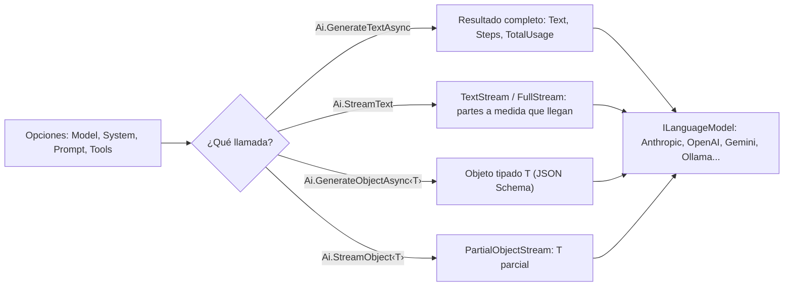

# Texto, streaming y objetos tipados

> 🇬🇧 [Read in English](Text-Streaming-and-Objects)



## ✍️ Generar texto

```csharp
using AiSdk;
using AiSdk.Anthropic;

var model = AnthropicProvider.Default.Messages("claude-opus-5-5"); // ANTHROPIC_API_KEY

var result = await Ai.GenerateTextAsync(new GenerateTextOptions
{
    Model = model,
    System = "Responde en español.",
    Prompt = "¿Qué es .NET?",
    ProviderOptions = AnthropicOptions.Create(effort: "medium", refusalFallback: true),
});

Console.WriteLine(result.Text);
Console.WriteLine(result.TotalUsage.OutputTokens);
```

Cambiar de proveedor es cambiar una línea:

```csharp
using AiSdk.OpenAI;
var model = OpenAIProvider.Default.Chat("gpt-5");                                   // OPENAI_API_KEY
var local = OpenAIProvider.Compatible("ollama", "http://localhost:11434/v1").Chat("llama3.2");
```

## 🌊 Streaming

```csharp
var stream = Ai.StreamText(new GenerateTextOptions { Model = model, Prompt = "Un haiku sobre C#" });

await foreach (var chunk in stream.TextStream)
    Console.Write(chunk);

var usage = await stream.TotalUsage;   // también: Text, Steps, FinishReason, ResponseMessages
```

`FullStream` expone todas las partes: `TextDeltaPart`, `ReasoningDeltaPart`, `ToolInputStartPart`,
`ToolCallStreamPart`, `ToolResultStreamPart`, `StartStepPart`/`FinishStepPart`, `FinishPart`, `ErrorPart`…
Los streams pueden consumirse varias veces y por varios consumidores.

## 🧱 Salida estructurada

```csharp
[Description("Una receta")]
public sealed record Recipe(string Name, List<string> Ingredients, int Minutes);

var recipe = (await Ai.GenerateObjectAsync<Recipe>(new() { Model = model, Prompt = "Empanadas de pino" })).Object;

// streaming de objetos parciales
await foreach (var partial in Ai.StreamObject<Recipe>(new() { Model = model, Prompt = "..." }).PartialObjectStream)
    Console.WriteLine(partial.Name);

// junto con herramientas, en un agente
var result = await Ai.GenerateTextAsync(new() { Model = model, Prompt = "...", Tools = [weather],
    Output = Output.Object<Weather>(), StopWhen = StopCondition.StepCountIs(5) });
var w = result.GetOutput<Weather>();

Output.Array<Recipe>();                 // listas
Output.Choice("positivo", "negativo");  // clasificación
```

El esquema se genera con `System.Text.Json.Schema.JsonSchemaExporter`, respetando `[Description]`,
nulabilidad, enums y parámetros de constructor requeridos. Los proveedores lo convierten al modo estricto
(`additionalProperties: false`) cuando lo exigen.

> [!TIP]
> Agrega atributos `[Description]` a tus records y propiedades: pasan a formar parte del JSON Schema y mejoran notablemente la salida del modelo.

## 🎛️ Streaming: suavizado y razonamiento en etiquetas

```csharp
var stream = Ai.StreamText(new GenerateTextOptions
{
    Model = deepseek.WithMiddleware(Middlewares.ExtractReasoning("think")),   // <think>...</think> → ReasoningPart
    Prompt = "...",
    StreamTransform = StreamTransforms.Smooth(TimeSpan.FromMilliseconds(15)), // palabra por palabra
});
```

`Middlewares.SimulateStreaming()` permite usar en streaming un modelo que solo implementa respuestas completas.

---

➡️ Siguiente: [Herramientas y agentes](es-Herramientas-y-agentes)
