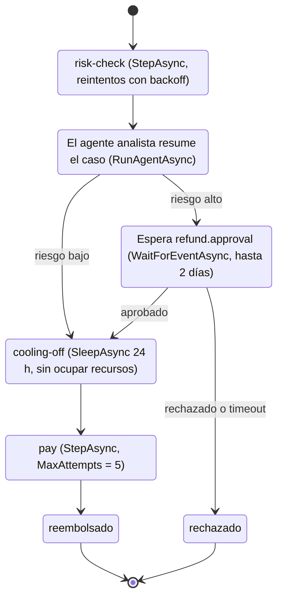

# Workflows durables y automatizaciones

> 🇬🇧 [Read in English](Workflows-and-Automations)

## ⏱️ Workflows durables, triggers y automatizaciones

`AiSdk.Workflows` ejecuta procesos largos que sobreviven reinicios (al estilo de Temporal, Inngest o el
Workflow DevKit de Vercel): cada paso se guarda y, al reanudar, los completados no se repiten.

El workflow `refund` del ejemplo de abajo, paso a paso:



> [!NOTE]
> Cada paso completado se guarda en el `IWorkflowStore`. Si el proceso se reinicia mientras la ejecución duerme o espera un evento, se reanuda ahí mismo sin repetir `risk-check` ni la llamada al agente.

```csharp
var refund = Workflow.Create<RefundRequest, string>("refund", async (ctx, r) =>
{
    var risk = await ctx.StepAsync("risk-check", ct => scoring.EvaluateAsync(r, ct));          // reintentos con backoff
    var resumen = await ctx.RunAgentAsync(analista, $"Resume el caso {r.OrderId}");             // agente como paso
    if (risk.High)
    {
        var ok = await ctx.WaitForEventAsync<Approval>("refund.approval", key: r.OrderId,        // aprobación humana
                                                       timeout: TimeSpan.FromDays(2));
        if (ok is not { Approved: true }) return "rechazado";
    }

    await ctx.SleepAsync("cooling-off", TimeSpan.FromHours(24));                               // duerme sin ocupar recursos
    await ctx.StepAsync("pay", ct => pagos.RefundAsync(r, ct), new StepOptions { MaxAttempts = 5 });
    return "reembolsado";
});

builder.Services.AddAiSdkWorkflows(w =>
{
    w.UseFileSystemStore("data/workflows");                     // o UseStore(tu IWorkflowStore: SQL, Redis...)
    w.AddWorkflow(refund);
    w.AddAutomation(Automation.Create("Informe diario", new CronTrigger("0 9 * * 1-5", "America/Santiago"), "daily-report", new { }));
    w.AddAutomation(new Automation { Id = "crm", Name = "Leads", Trigger = new WebhookTrigger(secret), Workflow = "lead" });
    w.AddAutomation(new Automation { Id = "paid", Name = "Pagados", Trigger = new EventTrigger("order.updated", new Dictionary<string, string> { ["status"] = "paid" }), Workflow = "invoice" });
});

app.MapWorkflows("/workflows", new WorkflowEndpointOptions
{
    CanStart = (http, workflow) => ValueTask.FromResult(workflow == "refund"),          // qué pueden iniciar los usuarios por HTTP
    CanSendEvent = async (http, e) =>                                                    // quién aprueba (obligatorio para eventos)
    {
        if (e.EventName != "refund.approval" || !http.User.IsInRole("aprobador") || e.WaitingRuns.Count == 0) return false;
        var engine = http.RequestServices.GetRequiredService<WorkflowEngine>();
        foreach (var run in e.WaitingRuns)                                               // nadie aprueba su propia solicitud
            if (await WorkflowEndpoints.GetRunOwnerAsync(engine, run) == EndpointSecurity.GetUserId(http)) return false;
        return true;
    },
});
// POST /workflows/refund/start · GET /workflows/runs/{id} · POST /workflows/events/refund.approval?key=O-77
// POST /workflows/hooks/crm (X-Webhook-Secret o firma HMAC X-Signature-256) · /automations · /runs/{id}/retry
```

Seguro por defecto:

- Todos los endpoints, salvo los webhooks, exigen autorización (`AllowAnonymous = true` para desactivarla explícitamente).
- El dueño sale de la autenticación (`ResolveUser`, por defecto el claim `NameIdentifier`/`sub`), nunca del cuerpo: las
  ejecuciones iniciadas por HTTP quedan con `TriggeredBy = "user:{id}"` y el servidor asigna el `Owner` de las
  automatizaciones. Cada usuario solo ve, cancela y reintenta sus ejecuciones y automatizaciones (`CanAccessRun`,
  `CanAccessAutomation`; `WorkflowEndpoints.GetRunOwnerAsync` ayuda a escribir reglas propias).
- `POST /events/{evento}` responde 403 hasta que configures `CanSendEvent`: recibe las ejecuciones que esperan el evento,
  así decides quién puede aprobar (normalmente no quien hizo la solicitud).
- Los POST exigen `Content-Type: application/json` (415 si no, también sin cuerpo): un formulario de otro sitio no puede
  enviar un JSON válido con las cookies del usuario.
- Las automatizaciones webhook creadas por HTTP necesitan secreto, y los secretos se ocultan al listarlas.

Disparadores: `CronTrigger` (5 o 6 campos, con zona horaria), `IntervalTrigger`, `OnceTrigger`, `EventTrigger`
(con filtro por contenido) y `WebhookTrigger` (secreto o firma HMAC-SHA256 en tiempo constante). Un servicio en segundo
plano dispara lo programado, reanuda ejecuciones dormidas y recupera las interrumpidas al arrancar.
`engine.RetryAsync(runId)` reintenta una ejecución fallida desde el paso que falló.

## 🗓️ Tareas programadas por agentes

("revisa los precios cada día hábil a las 9")

```csharp
w.ConfigureEngine((engine, sp) => engine.AddAgentTasks(new AgentTaskOptions
{
    Agent = sp => sp!.GetRequiredService<AsistenteAgent>(),
    OnCompleted = (r, sp, ct) => correo.EnviarAsync(r.Owner, r.Task, r.Text, ct),   // entrega del resultado
    DefaultTimeZone = "America/Santiago",
}));

Tools = AgentTasks.CreateTools(engine, options),   // schedule_task, list/cancel/run_scheduled_task_now, get_task_result
```

Cada usuario (`Context["userId"]`) solo ve y gestiona sus tareas, con un intervalo mínimo y un máximo de tareas configurables.

> [!WARNING]
> Un `WebhookTrigger` sin secreto acepta a cualquiera que pueda llegar a `/hooks/{id}`: configura siempre uno, sobre todo si publicas los webhooks sin autenticación de usuario (`app.MapWorkflowWebhooks()`).

---

➡️ Siguiente: [RAG y almacenes vectoriales](es-RAG-y-almacenes-vectoriales)
