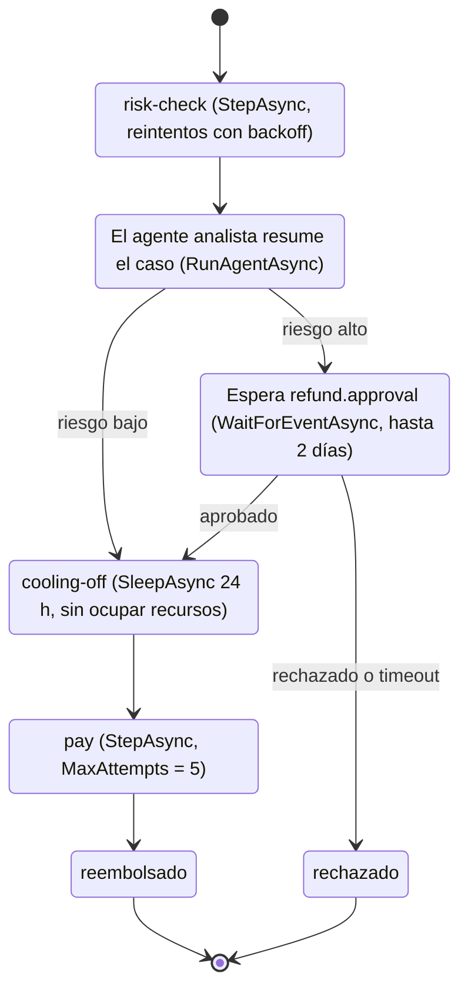

# Workflows durables y automatizaciones

> 🇬🇧 [Read in English](Workflows-and-Automations)

## ⏱️ Workflows durables, triggers y automatizaciones

`AiSdk.Workflows` ejecuta procesos largos que sobreviven reinicios (al estilo de Temporal, Inngest o el
Workflow DevKit de Vercel): cada paso se guarda y, al reanudar, los completados no se repiten.

El workflow `refund` del ejemplo de abajo, paso a paso:



> [!NOTE]
> Cada paso completado se guarda en el `IWorkflowStore`. Si el proceso se reinicia mientras la ejecución duerme o espera un evento, se reanuda ahí mismo sin repetir `risk-check` ni la llamada al agente.

```csharp
var refund = Workflow.Create<RefundRequest, string>("refund", async (ctx, r) =>
{
    var risk = await ctx.StepAsync("risk-check", ct => scoring.EvaluateAsync(r, ct));          // reintentos con backoff
    var resumen = await ctx.RunAgentAsync(analista, $"Resume el caso {r.OrderId}");             // agente como paso
    if (risk.High)
    {
        var ok = await ctx.WaitForEventAsync<Approval>("refund.approval", key: r.OrderId,        // aprobación humana
                                                       timeout: TimeSpan.FromDays(2));
        if (ok is not { Approved: true }) return "rechazado";
    }

    await ctx.SleepAsync("cooling-off", TimeSpan.FromHours(24));                               // duerme sin ocupar recursos
    await ctx.StepAsync("pay", ct => pagos.RefundAsync(r, ct), new StepOptions { MaxAttempts = 5 });
    return "reembolsado";
});

builder.Services.AddAiSdkWorkflows(w =>
{
    w.UseFileSystemStore("data/workflows");                     // o UsePostgresStore(...) para varias máquinas, o UseStore(tu IWorkflowStore)
    w.AddWorkflow(refund);
    w.AddAutomation(Automation.Create("Informe diario", new CronTrigger("0 9 * * 1-5", "America/Santiago"), "daily-report", new { }));
    w.AddAutomation(new Automation { Id = "crm", Name = "Leads", Trigger = new WebhookTrigger(secreto), Workflow = "lead" });   // secreto = WebhookSignature.CreateSecret()
    w.AddAutomation(new Automation { Id = "paid", Name = "Pagados", Trigger = new EventTrigger("order.updated", new Dictionary<string, string> { ["status"] = "paid" }), Workflow = "invoice" });
});

app.MapWorkflows("/workflows", new WorkflowEndpointOptions
{
    CanStart = (http, workflow) => ValueTask.FromResult(workflow == "refund"),          // qué pueden iniciar los usuarios por HTTP
    CanSendEvent = async (http, e) =>                                                    // quién aprueba (obligatorio para eventos)
    {
        if (e.EventName != "refund.approval" || !http.User.IsInRole("aprobador") || e.WaitingRuns.Count == 0) return false;
        var engine = http.RequestServices.GetRequiredService<WorkflowEngine>();
        foreach (var run in e.WaitingRuns)                                               // nadie aprueba su propia solicitud
            if (await WorkflowEndpoints.GetRunOwnerAsync(engine, run) == EndpointSecurity.GetUserId(http)) return false;
        return true;
    },
});
// POST /workflows/refund/start · GET /workflows/runs/{id} · POST /workflows/events/refund.approval?key=O-77
// POST /workflows/hooks/crm (firmado: X-Signature-256 + X-Webhook-Timestamp) · /automations · /runs/{id}/retry
```

Seguro por defecto:

- Todos los endpoints, salvo los webhooks, exigen autorización (`AllowAnonymous = true` para desactivarla explícitamente).
- El dueño sale de la autenticación (`ResolveUser`, por defecto el claim `NameIdentifier`/`sub`), nunca del cuerpo: las
  ejecuciones iniciadas por HTTP quedan con `TriggeredBy = "user:{id}"` y el servidor asigna el `Owner` de las
  automatizaciones. Cada usuario solo ve, cancela y reintenta sus ejecuciones y automatizaciones (`CanAccessRun`,
  `CanAccessAutomation`; `WorkflowEndpoints.GetRunOwnerAsync` ayuda a escribir reglas propias).
- `POST /events/{evento}` responde 403 hasta que configures `CanSendEvent`: recibe las ejecuciones que esperan el evento,
  así decides quién puede aprobar (normalmente no quien hizo la solicitud). Solo se reanudan esas ejecuciones
  (`WorkflowEngine.SendEventToRunsAsync`): una que empiece a esperar el evento después de la autorización sigue esperando.
- Los POST exigen `Content-Type: application/json` (415 si no, también sin cuerpo): un formulario de otro sitio no puede
  enviar un JSON válido con las cookies del usuario.
- Las automatizaciones webhook creadas por HTTP necesitan secreto, y los secretos se ocultan al listarlas.

Disparadores: `CronTrigger` (5 o 6 campos, con zona horaria), `IntervalTrigger`, `OnceTrigger`, `EventTrigger`
(con filtro por contenido) y `WebhookTrigger` (firma HMAC-SHA256 con marca de tiempo, comparada en tiempo constante). Un
servicio en segundo plano dispara lo programado, reanuda ejecuciones dormidas y recupera las interrumpidas.
`engine.RetryAsync(runId)` reintenta una ejecución fallida desde el paso que falló. Los disparadores se validan al crear
la automatización: una expresión cron o una zona horaria que no existe en la máquina, un intervalo menor a un segundo o
un webhook sin secreto lanzan `ArgumentException`.

## 🔐 Webhooks

Un `WebhookTrigger` exige un secreto (al menos 16 caracteres; `WebhookSignature.CreateSecret()` genera 256 bits).
Por defecto, el emisor firma `"{timestamp}.{cuerpo}"` con HMAC-SHA256 y envía estas cabeceras:

| Cabecera | Contenido |
|---|---|
| `X-Signature-256` | `sha256=` + HMAC-SHA256 en hexadecimal de `"{timestamp}.{cuerpo tal cual}"` con el secreto |
| `X-Webhook-Timestamp` | Hora Unix en segundos; debe estar dentro de `WorkflowEngineOptions.WebhookTolerance` (5 min) |
| `X-Webhook-Id` | Id único de entrega (opcional): los reintentos con el mismo id devuelven la misma ejecución |

```csharp
// En el emisor (o en una prueba): firma exactamente los bytes que envías.
var timestamp = DateTimeOffset.UtcNow.ToUnixTimeSeconds();
request.Headers.Add(WebhookSignature.SignatureHeader, WebhookSignature.Sign(secreto, timestamp, cuerpo));
request.Headers.Add(WebhookSignature.TimestampHeader, timestamp.ToString(CultureInfo.InvariantCulture));
request.Headers.Add(WebhookSignature.DeliveryIdHeader, idEntrega);
```

Una petición capturada no se puede repetir: la misma firma devuelve la ejecución que ya creó (también en otra réplica)
y, pasada la tolerancia, se rechaza. Los emisores que no pueden firmar así se habilitan de forma explícita:
`new WebhookTrigger(secreto) { Verification = WebhookVerification.BodySignature }` (HMAC solo del cuerpo, el
`X-Hub-Signature-256` de GitHub; las repeticiones solo se detectan con `X-Webhook-Id` / `X-GitHub-Delivery`) o
`WebhookVerification.SharedSecret` (cabecera `X-Webhook-Secret`). Los webhooks sin autenticar exigen
`new WebhookTrigger { AllowUnauthenticated = true }`; en ese caso usa el id aleatorio que genera `Automation.Create`
(128 bits), porque la URL es la única protección. El código que llama al motor directamente debe usar
`TriggerWebhookAsync(id, WebhookRequest.FromHeaders(cuerpo, nombre => cabeceras[nombre]))`.

## 🧱 Fiabilidad, varias réplicas y retención

- **Las automatizaciones que fallan se aíslan.** Si una automatización no se puede disparar (su workflow ya no está
  registrado, la zona horaria no existe, el almacén está caído...), las demás se disparan igual. El error queda en
  `Automation.LastError` y `ConsecutiveFailures`, el siguiente intento se aplaza con espera exponencial
  (`AutomationRetryDelay`, hasta `MaxAutomationRetryDelay`) y tras `MaxAutomationFailures` (5) se desactiva;
  `SetAutomationEnabledAsync(id, true)` la reactiva. `WorkflowEngineOptions.OnError` recibe estos errores.
- **La cancelación es definitiva.** `CancelAsync` guarda `Cancelled` y avisa al `ctx.CancellationToken` de la
  ejecución; un workflow que sigue corriendo no puede sobrescribirlo (sus guardados se rechazan) ni empieza pasos nuevos.
- **Varias réplicas pueden compartir un almacén.** Los guardados usan concurrencia optimista (`WorkflowRun.Version`,
  `Automation.Version`; un guardado desactualizado lanza `WorkflowConcurrencyException`). Cada ejecución se reclama con
  un lease (`LeaseOwner`, `LeaseExpiresAt`, `LeaseDuration` = 2 min) que se renueva mientras avanza: otra réplica solo la
  retoma si el lease vence (la réplica murió). Cada ocurrencia programada crea una ejecución con id determinista, así
  que se dispara una vez aunque dos réplicas revisen a la vez. `FileSystemWorkflowStore` admite varios procesos en la
  misma máquina (archivo de bloqueo); entre máquinas usa `PostgresWorkflowStore` (sección siguiente) u otro almacén de
  base de datos.
- **Crecimiento acotado.** El motor ya no lista todas las ejecuciones en cada ciclo: usa consultas indexadas
  (`ListDueRunsAsync`, `ListRunsWaitingForEventAsync`, `ListDueAutomationsAsync`). Las ejecuciones terminadas se borran
  pasado `RunRetention` (30 días; `null` las conserva) o a pedido con `engine.PurgeRunsAsync(antes)`, e
  `InMemoryWorkflowStore` conserva como mucho `maxFinishedRuns` (10 000) ejecuciones terminadas.

> [!NOTE]
> Un `IWorkflowStore` propio debe verificar la versión al guardar (`UPDATE ... WHERE id = @id AND version = @version`,
> y un insert que falle si el id existe cuando la versión es 0) e implementar las consultas indexadas con los criterios
> de `WorkflowRunQueries`.

## 🐘 Varias máquinas: el almacén PostgreSQL

`FileSystemWorkflowStore` solo coordina procesos de una misma máquina (el bloqueo de archivos no es fiable en discos de
red). Para ejecutar varias réplicas (pods, VMs, regiones detrás de un balanceador) sobre una misma base de datos, usa
`AiSdk.Net.Workflows.Postgres`:

```bash
dotnet add package AiSdk.Net.Workflows.Postgres
```

```csharp
using AiSdk.Workflows.Postgres;

builder.Services.AddAiSdkWorkflows(w =>
{
    w.UsePostgresStore(builder.Configuration.GetConnectionString("workflows")!);
    // o w.UsePostgresStore(dataSource), o w.UsePostgresStore() con la NpgsqlDataSource registrada en el contenedor
    // (AddNpgsqlDataSource, Aspire); opciones: new PostgresWorkflowStoreOptions { Schema = "workflows" }
    w.AddWorkflow(refund);
});
```

Todas las réplicas ejecutan el mismo código contra la misma base; no hay nada más que coordinar (cada proceso tiene su
propio `InstanceId`):

- Una ejecución iniciada en una réplica se puede reanudar con un evento, webhook o petición HTTP que llega a otra.
- Una ejecución dormida o vencida la reclama una sola réplica (concurrencia optimista + lease); si una réplica muere, otra
  retoma sus ejecuciones al vencer el lease. Cada ocurrencia programada se dispara una vez.
- Los guardados son `UPDATE ... WHERE id = $1 AND version = $n` e `INSERT ... ON CONFLICT (id) DO NOTHING` (0 filas =
  `WorkflowConcurrencyException`).
- Los ciclos del motor solo leen las ejecuciones activas mediante índices parciales, nunca el historial. La retención borra
  las terminadas más antiguas por lotes con `FOR UPDATE SKIP LOCKED`, así que las réplicas que purgan a la vez no se esperan.

| Objeto | Contenido |
|---|---|
| `{prefijo}runs` | Una fila por ejecución: `data` (la ejecución completa en `json`) más `status`, `workflow_name`, `version`, `created_at`, `updated_at`, `finished_at`, `resume_at`, `lease_expires_at`, `wait_event`, `wait_key` |
| `{prefijo}automations` | Una fila por automatización: `data` más `enabled`, `next_run_at`, `created_at`, `version` |
| `runs_resume_idx`, `runs_lease_idx` | Índices parciales (dormidas/en espera y pendientes/en curso) para `ListDueRunsAsync` |
| `runs_waiting_idx` | Índice parcial (evento y clave) para `ListRunsWaitingForEventAsync` |
| `runs_finished_idx` | Índice parcial para la retención (`DeleteFinishedRunsAsync`) |
| `runs_created_idx`, `runs_status_idx`, `runs_workflow_idx` | Listados, las más recientes primero (`ListRunsAsync`) |
| `automations_due_idx` | Índice parcial (automatizaciones activas) para `ListDueAutomationsAsync` |

`PostgresWorkflowStoreOptions`: `Schema` (`public`), `TablePrefix` (`aisdk_workflow_`) y `CreateIfNotExists` (`true`).
El esquema, las tablas y los índices se crean en el primer uso si falta alguno, de forma idempotente y segura aunque
arranquen varias réplicas a la vez (bloqueo consultivo); cuando todo existe no se ejecuta DDL. Si la aplicación se conecta
con un usuario sin permisos de DDL, pon `CreateIfNotExists = false` y llama a `EnsureSchemaAsync()` desde el despliegue
con un usuario que los tenga. El esquema y el prefijo se validan (letras, dígitos y `_`, 63 caracteres como máximo por
nombre) y se escriben entre comillas.

> [!NOTE]
> La ejecución se guarda como `json`, no `jsonb`: `jsonb` reordena las propiedades y System.Text.Json exige que el
> discriminador de un tipo polimórfico (`kind` de un disparador, `type` de una parte de mensaje guardada por un paso) vaya
> primero; además rechaza `\u0000`. Las consultas usan las columnas extraídas, cuyas fechas tienen la precisión de
> PostgreSQL (microsegundos); el JSON conserva la exacta.

## 🗓️ Tareas programadas por agentes

("revisa los precios cada día hábil a las 9")

```csharp
w.ConfigureEngine((engine, sp) => engine.AddAgentTasks(new AgentTaskOptions
{
    Agent = sp => sp!.GetRequiredService<AsistenteAgent>(),
    OnCompleted = (r, sp, ct) => correo.EnviarAsync(r.Owner, r.Task, r.Text, ct),   // entrega del resultado
    DefaultTimeZone = "America/Santiago",
}));

Tools = AgentTasks.CreateTools(engine, options),   // schedule_task, list/cancel/run_scheduled_task_now, get_task_result
```

Cada usuario (`Context["userId"]`, ver `OwnerKey`) solo ve y gestiona sus tareas, con un intervalo mínimo y un máximo
de tareas configurables. Sin usuario en el contexto las herramientas se niegan a operar (no hay tareas compartidas) y,
cuando una tarea se ejecuta, el agente también recibe a su dueño en `Context`, así sus herramientas actúan en nombre de
ese usuario. Las expresiones cron se revisan durante una semana completa: el menor intervalo entre ejecuciones
consecutivas debe alcanzar `MinimumInterval`.

> [!WARNING]
> Los webhooks se publican sin autenticación de usuario (`app.MapWorkflowWebhooks()`): el secreto y la firma son su única protección. No uses `AllowUnauthenticated` fuera de pruebas o redes de confianza.

---

➡️ Siguiente: [RAG y almacenes vectoriales](es-RAG-y-almacenes-vectoriales)
